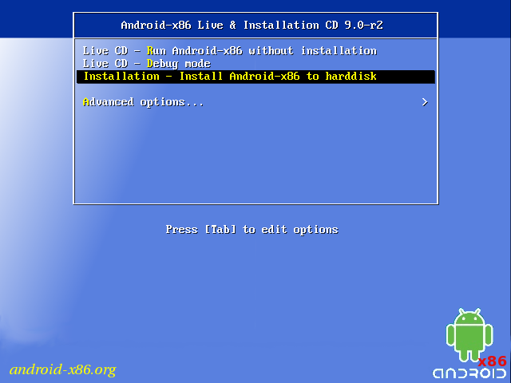
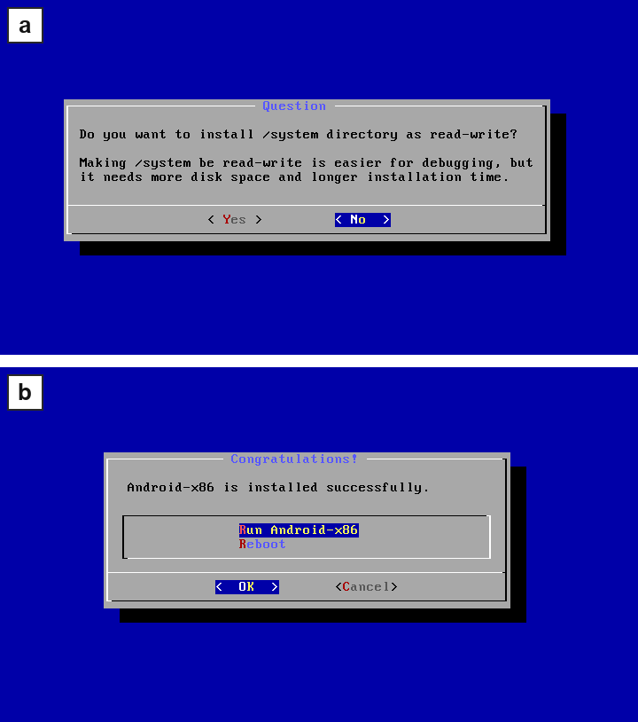
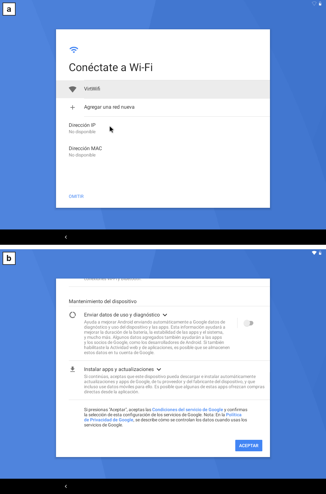
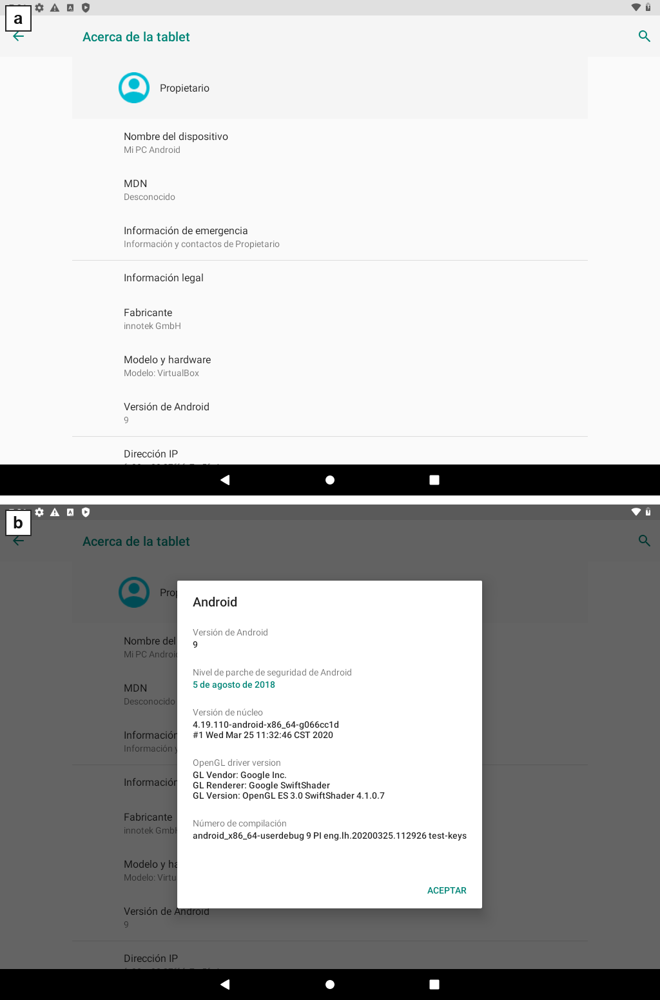
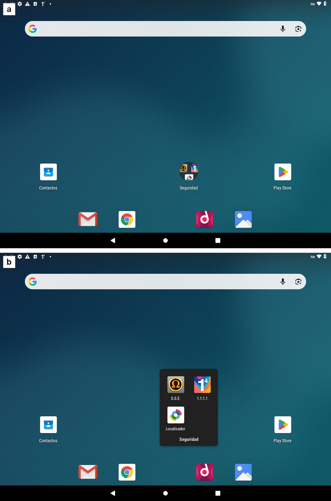
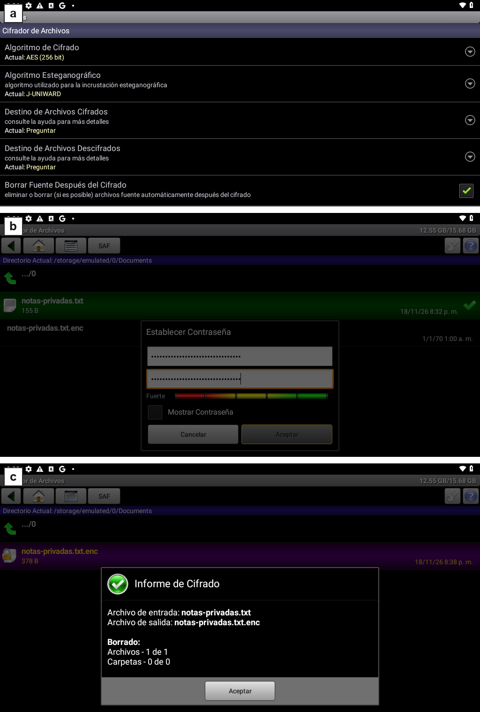
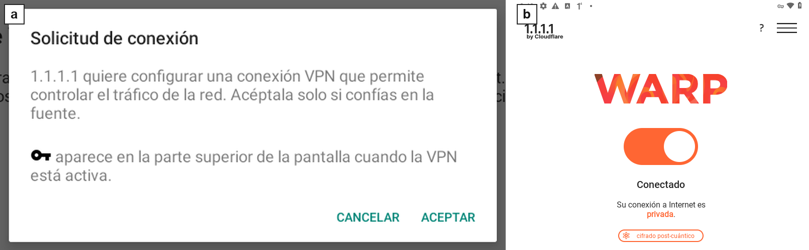
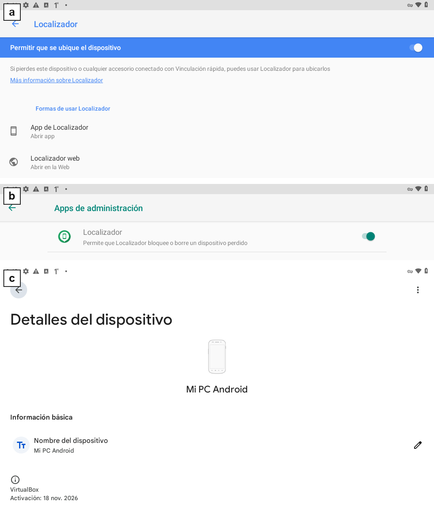

# Android-x86 tablet on VirtualBox

Coursework for Operating Systems II at Fundación Universitaria del Área Andina, November 2026. The assignment, "Mi PC Android", asked for an Android ROM installed in a virtual machine set up as a tablet, then customized and protected with apps from Google Play: one to encrypt files, one to secure network traffic and one to locate or wipe the device.

The repository has two PowerShell scripts, one that recreates the virtual machine and one that audits the tablet's security settings over ADB, plus the report I submitted (in Spanish) and screenshots of the main steps.

## Setup

| Component | Value |
| --- | --- |
| Host | Windows 11 Home, Intel Core i7-11800H, 16 GB of RAM |
| Hypervisor | VirtualBox 7.2.22 |
| ROM | Android-x86 9.0-r2: Android 9 (API 28), Linux kernel 4.19.110 |
| Virtual machine | 2 vCPUs, 3 GB of RAM, 16 GB dynamic VDI on SATA, VBoxVGA with 128 MB and no 3D acceleration, NAT, USB tablet pointer, BIOS |

Phone ROMs are built for ARM processors and would not boot on this host, so I used Android-x86, which is built from the Android Open Source Project for Intel and AMD processors. With a 1024 x 768 display at 160 dpi, Android treats the machine as a tablet.

WSL 2 and Docker already had the Windows hypervisor running, so VirtualBox could not use VT-x directly and ran the VM on top of the Windows hypervisor. It is slower, but nothing had to be turned off.

## Creating the VM

Requirements: VirtualBox 7.2 and Windows PowerShell 5.1, the version I tested with. The ISO is `android-x86_64-9.0-r2.iso`; its SHA-1 is published in the [9.0-r2 release note](https://www.android-x86.org/releases/releasenote-9-0-r2.html).

```powershell
.\scripts\new-vm.ps1 -IsoPath "$HOME\Downloads\android-x86_64-9.0-r2.iso"
```

The script checks the ISO against the SHA-1 in the release note before creating anything, and refuses to overwrite a VM with the same name. If a step fails after the VM is registered, it removes that VM and the disk it created, so it can run again. It also forwards host port 5555 to the guest's ADB port, bound to 127.0.0.1 so that only the host can reach it. If script execution is disabled on your machine, run it with `powershell -ExecutionPolicy Bypass -File .\scripts\new-vm.ps1 -IsoPath ...`.

## Installing Android-x86

The installer is interactive:

1. Boot from the ISO and choose "Installation - Install Android-x86 to harddisk".
2. Choose "Create/Modify partitions", answer "No" to GPT (the VM boots with BIOS, so an MBR table is enough) and create one primary, bootable partition with cfdisk.
3. Select `sda1` and format it as ext4.
4. Install GRUB.
5. Answer "No" when the installer asks whether /system should be writable.
6. Eject the ISO and reboot. The VirtualBox installer for Windows does not add VBoxManage to the PATH, so the command uses its full path:

```powershell
& "$env:ProgramFiles\Oracle\VirtualBox\VBoxManage.exe" storageattach android-x86-tablet --storagectl SATA --port 1 --device 0 --medium emptydrive
```

ext4 keeps Linux file owners and permissions, which Android relies on to keep each app in its own sandbox. With /system protected from writes, apps cannot modify the operating system files.

## Configuration

On first boot I picked Spanish, joined VirtWifi (the VirtualBox NAT network as Android shows it), turned off usage and diagnostics reporting to Google and set a PIN of six digits. Then I switched to the dark theme, set the screen timeout to 2 minutes, hid sensitive notification content on the lock screen, renamed the device to "Mi PC Android" and put the three security apps in a folder on the home screen.

## Security apps

| Need | App | Version | How I checked it |
| --- | --- | --- | --- |
| Encrypt files | SSE - File & Text Encryption, by Paranoia Works | 3.3.1 | AES-256 selected and the original file set to be deleted after encryption. A test file encrypted with a password of 32 characters starts with the `SSEFE` header, and the original is gone. |
| Secure traffic | 1.1.1.1 + WARP, by Cloudflare | 6.38.12 | After I approved the VPN profile, `tun0` came up with 172.16.0.2 and Cloudflare's trace page answered `warp=on`. |
| Locate or wipe | Find Hub, by Google (Localizador in the Spanish interface) | 3.1.805 | Registered as a device admin with the `wipe-data`, `force-lock` and `reset-password` policies. |

I only considered apps that are free, come from a known publisher, need no extra account and could be tested inside the VM. That ruled out Proton VPN, which requires a Proton account, and the locator apps from other developers in the search results, one of them a sponsored listing with ads and purchases inside the app.

## Audit

`scripts/audit-tablet.ps1` connects over ADB and reads the settings that matter for security. It does not change anything on the device.

ADB has to listen on TCP inside the guest first. In the console that opens with Alt+F1 (Alt+F7 goes back to the interface), run:

```sh
su
setprop persist.adb.tcp.port 5555
stop adbd
start adbd
```

Then, from the host, with [Android SDK Platform-Tools](https://developer.android.com/tools/releases/platform-tools) unzipped, for example in Downloads:

```powershell
.\scripts\audit-tablet.ps1 -Adb "$HOME\Downloads\platform-tools\adb.exe"
```

If `adb` is already on the PATH, `-Adb` can be left out.

Output from the tablet on 19 November 2026:

```text
Check                     Value                                                                       Status
-----                     -----                                                                       ------
Device                    innotek GmbH VirtualBox, 1024x768 at 160 dpi                                Info
Android version           9 (API 28)                                                                  Info
Build                     userdebug, test-keys                                                        Risk
Security patch            2018-08-05 (3029 days old)                                                  Risk
Kernel                    4.19.110-android-x86_64-g066cc1d                                            Info
SELinux                   Permissive                                                                  Risk
Storage encryption        unsupported                                                                 Risk
Root shell                su at /system/bin/su, /system/xbin/su                                       Risk
ADB authorization         not required                                                                Risk
ADB over TCP              port 5555                                                                   Warning
Screen lock               PIN                                                                         OK
Screen timeout            120 s                                                                       OK
Lock screen notifications sensitive content hidden                                                    OK
Location                  on (gps,network)                                                            OK
Device admin              Find Hub (wipe-data, reset-password, force-lock, disable-keyguard-features) OK
VPN tunnel                tun0 172.16.0.2/32                                                          OK
Security apps             SSE 3.3.1, 1.1.1.1 + WARP 6.38.12, Find Hub 3.1.805-02                      OK
```

## Findings

Most of the risks come with the build itself:

- The security patch level is 5 August 2018 and Android 9 no longer receives updates, so every vulnerability fixed in later Android security bulletins is still open.
- It is a userdebug build signed with test keys: `su` is installed and ADB accepts any host without asking for authorization.
- SELinux runs in permissive mode, so its policy is logged but not enforced. My report did not cover this; the audit script found it.
- Storage encryption is not supported (`ro.crypto.state` is `unsupported`), so anyone with a copy of the virtual disk can read the data. SSE closes part of that gap for the files that matter.
- GRUB reports "No TPM detected", so the boot is not measured. VirtualBox can add a virtual TPM.

The settings I controlled ended up as intended: PIN lock, a screen timeout of 2 minutes, hidden notification content, /system protected from writes, WARP connected and Find Hub able to lock or wipe the tablet.

If this were an employee's own tablet asking to join a company network, the 2018 patch level alone would be reason enough to refuse it, whatever apps it has installed. The image is fine for a lab and nothing more.

## Limitations

- I did not test a remote wipe, because it would have erased the installation documented here.
- The VM has no GPS, so Find Hub locates it from the network, and only approximately.
- WARP moves trust to Cloudflare, which can still see traffic metadata.
- The screen lock check reads `/data/system/locksettings.db` through `su`. On a device without root it reports "not readable without root".

## Report and video

The submitted report, in Spanish, is in [docs/report-es.pdf](docs/report-es.pdf). It walks through every step with figures and explains each decision and the security evaluation.

The [walkthrough video](https://youtu.be/7-u0FoqGI-o) (4:36, in Spanish) covers the ROM, the virtual machine, the Android version and the three apps.

## Screenshots

| | |
| --- | --- |
| <br>Boot menu of the ISO | <br>/system kept protected from writes, installation finished |
| <br>VirtWifi network and diagnostics turned off | <br>Android 9, kernel 4.19.110, patch level 2018-08-05 |
| <br>Home screen and the security apps folder | <br>SSE settings, password strength and encryption report |
| <br>VPN approval and WARP connected | <br>Find Hub: location, device admin and registered device |

## License

The scripts are released under the MIT License (see [LICENSE](LICENSE)). The report and the screenshots in `docs/` are not covered by it.
